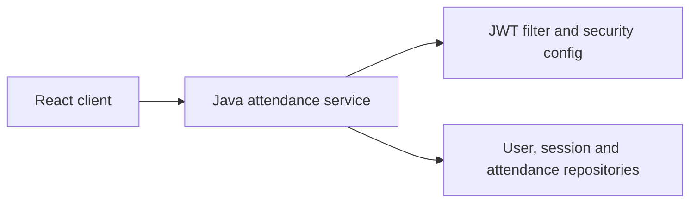

# QR Attendance System

A QR-enabled attendance application with Java backend source and a React interface. The backend models users, roles, sessions, and attendance; the interface contains login, scan, user-dashboard, and admin-dashboard pages.

## Architecture

## Repository layout

- `backend/src/main/java/com/qrattendance/controller/` — attendance, auth, and profile controllers.
- `backend/src/main/java/com/qrattendance/security/` — JWT utilities and filter.
- `backend/src/main/java/com/qrattendance/model/` and `repository/` — domain and data-access types.
- `backend/src/main/resources/application.yml` — service configuration.
- `frontend/src/pages/` — login, scan, and dashboards.

## Setup status

No Maven/Gradle build file or frontend package manifest is tracked, so a reproducible local build cannot be documented. Review `application.yml` for database and secret settings before running; replace development secrets and never commit production credentials.

## API and next steps

Controller source is the API reference. Add build manifests, a sanitized sample configuration, database setup instructions, and endpoint examples. No deployment configuration or `LICENSE` file was found, so reuse terms are unspecified.
