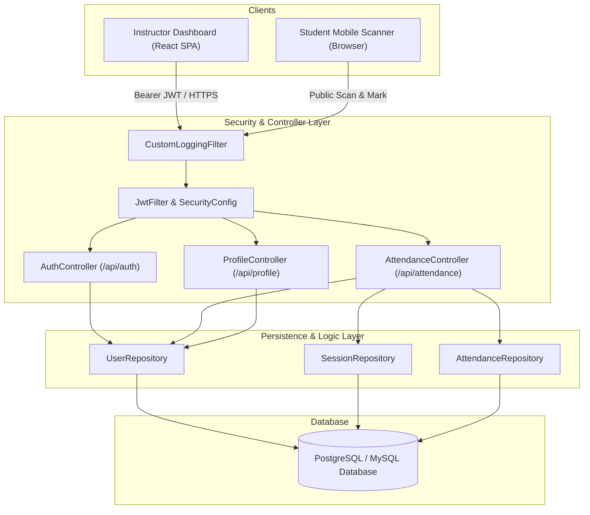

# 📱 Real-Time QR Attendance System

<div align="center">

[](https://spring.io/projects/spring-boot)
[](https://www.oracle.com/java/)
[](https://react.dev/)
[](https://vitejs.dev/)
[](https://www.postgresql.org/)
[](https://jwt.io/)

<p align="center">
  A high-integrity, automated attendance tracking platform powered by <strong>Spring Boot 3</strong>, <strong>Spring Security</strong>, <strong>JPA/Hibernate</strong>, and a modern <strong>React 18</strong> single-page dashboard.
</p>

</div>

---

## 🌟 Key Highlights

- **Dynamic Session-Bound QR Generation**: Instructors generate unique, cryptographically random session tokens (`UUID`) paired with designated subjects, time slots, and date stamps.
- **Strict Anti-Spoofing & Duplicate Prevention**: Database uniqueness constraints and JPA checks (`existsBySessionAndStudentUid`) prevent duplicate check-ins for the same student identifier within an active session.
- **Real-Time Instructor Dashboard**: Instructors can view real-time attendee lists as scans happen, toggle session active status instantly, and inspect historical session logs.
- **Frictionless Student Check-in**: Students scan the live QR code from their mobile browser (e.g. camera, Google Lens) and submit their identifier directly without mandatory multi-step login.
- **Stateless JWT Security**: Protected administrative endpoints guarded by custom Spring Security filters and BCrypt password encryption.

---

## 🏗️ System Architecture



---

## 📂 Repository Structure

```
qr-attendance-system/
├── backend/
│   ├── pom.xml                               # Maven project definition (Spring Boot 3.2.4)
│   └── src/
│       ├── main/
│       │   ├── java/com/qrattendance/
│       │   │   ├── QrAttendanceApplication.java
│       │   │   ├── config/SecurityConfig.java
│       │   │   ├── controller/               # AuthController, AttendanceController, ProfileController
│       │   │   ├── model/                    # User, Session, Attendance, Role
│       │   │   ├── repository/               # UserRepository, SessionRepository, AttendanceRepository
│       │   │   └── security/                 # JwtFilter, JwtUtil, CustomLoggingFilter
│       │   └── resources/application.yml     # Database & server configuration
│       └── test/
│           └── java/com/qrattendance/security/JwtUtilTest.java
├── frontend/
│   ├── package.json                          # Vite + React 18 configuration
│   ├── vite.config.js                        # Dev proxy to backend port 8080
│   ├── index.html                            # Application entrypoint
│   └── src/
│       ├── api.js                            # Axios instance with auth interceptors
│       ├── App.jsx                           # Route declarations
│       ├── main.jsx                          # Root DOM renderer
│       ├── index.css                         # Dark glassmorphic design system
│       ├── context/AuthContext.jsx           # Global authentication state
│       ├── pages/                            # AdminDashboard, ScanPage, Login, UserDashboard
│       └── assets/                           # Media & brand assets
└── README.md
```

---

## 📡 REST API Reference

### 🔐 Authentication (`/api/auth`)

| Method | Endpoint | Description | Public |
| :--- | :--- | :--- | :---: |
| `POST` | `/api/auth/register` | Register a new instructor / admin user | ✅ |
| `POST` | `/api/auth/login` | Authenticate with email/password and obtain JWT token | ✅ |

### 📋 Attendance & Session Management (`/api/attendance`)

| Method | Endpoint | Description | Auth Required |
| :--- | :--- | :--- | :---: |
| `POST` | `/api/attendance/generate-qr` | Create a new active attendance session | 🔒 Bearer Token |
| `POST` | `/api/attendance/session/{token}/stop` | Terminate and deactivate a running QR session | 🔒 Bearer Token |
| `GET` | `/api/attendance/session/{token}` | Fetch session metadata (subject, time, instructor info) | ✅ Public |
| `POST` | `/api/attendance/mark` | Record student attendance against a session token | ✅ Public |
| `GET` | `/api/attendance/records/{token}` | Retrieve all checked-in student records for a session | 🔒 Bearer Token |
| `GET` | `/api/attendance/history` | Retrieve past sessions created by the authenticated user | 🔒 Bearer Token |

### 👤 Profile Management (`/api/profile`)

| Method | Endpoint | Description | Auth Required |
| :--- | :--- | :--- | :---: |
| `GET` | `/api/profile` | Retrieve authenticated user profile | 🔒 Bearer Token |
| `PUT` | `/api/profile` | Update profile details (name, employee ID, avatar) | 🔒 Bearer Token |

---

## 🚀 Getting Started

### 1. Prerequisites
- **Java**: OpenJDK 17 or higher
- **Maven**: Apache Maven 3.8+
- **Node.js**: v18+ & npm
- **Database**: PostgreSQL 14+ or MySQL 8.0+

### 2. Backend Setup
```bash
cd backend

# Configure your database credentials in src/main/resources/application.yml
# Run unit and integration tests
mvn clean test

# Launch the Spring Boot application
mvn spring-boot:run
```
The backend server will start on `http://localhost:8080`.

### 3. Frontend Setup
```bash
cd frontend

# Install client dependencies
npm install

# Start Vite local development server
npm run dev
```
Open `http://localhost:5173` in your browser.

---

## 🧪 Testing

Execute backend test suites via Maven:
```bash
cd backend
mvn test
```

---

## 🛡️ License

This project is licensed under the MIT License.
